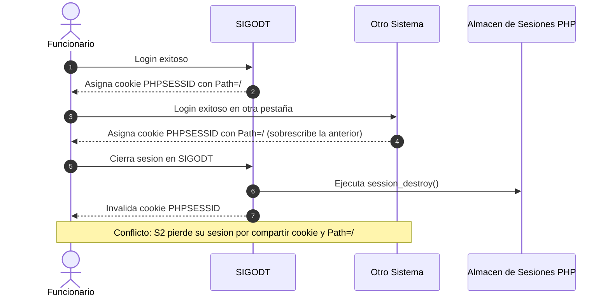
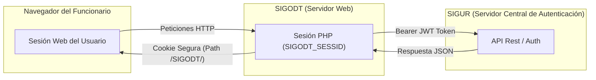

# Guía Técnica: Aislamiento de Sesiones en Servidores Compartidos y Comparativa Arquitectónica (Sesiones de Servidor vs. JWT en Cookies)

> **Destinatarios:** Equipos de desarrollo, líderes técnicos y arquitectos de software de la Gerencia de Tecnología de la Información.  
> **Propósito:** Explicar la causa raíz del cierre cruzado de sesiones en servidores compartidos (`10.10.10.16`), documentar la solución implementada en SIGODT y detallar la justificación técnica de seguridad y rendimiento frente al uso de tokens JWT en cookies de cliente.

---

## 1. El Problema: Cierre Cruzado de Sesiones

### 1.1 Contexto
En la infraestructura municipal, múltiples sistemas web institucionales coexisten bajo la misma dirección IP o nombre de host:
- `http://10.10.10.16/SIGODT/` (Sistema de Órdenes de Giro)
- `http://10.10.10.16/sisTramite/` (Sistema de Trámite Documentario)
- `http://10.10.10.16/sisRentas/` (Sistema Tributario / Recaudación)
- `http://10.10.10.16/sigur/` (Core de Seguridad y Autenticación Central)

### 1.2 Causa Raíz
Por defecto, PHP inicializa las sesiones con:
- **Nombre de cookie:** `PHPSESSID`
- **Ámbito (`Path`):** `/` (toda la raíz del servidor)

Cuando un funcionario tiene abiertas pestañas de dos sistemas diferentes en el mismo navegador:
1. Ambos sistemas compiten y **sobreescriben la misma cookie `PHPSESSID`**.
2. Al presionar "Cerrar sesión" en cualquiera de ellos, la función nativa `session_destroy()` elimina el archivo de sesión en el servidor y borra la cookie en `/`.
3. **Efecto secundario:** El usuario es expulsado de todos los demás sistemas abiertos en ese mismo navegador.



---

## 2. Análisis del Enfoque Alternativo (JWT en Cookies de Cliente)

En otros sistemas se planteó mitigar esto mediante el siguiente patrón:

```php
// Código del sistema alternativo (auth.php):
$param = $data->data;
$token = $jwt->encrypt($param, 'session', 13600); // 3.7 horas de vigencia
$jwt->setCookie("session", $token, 0, "/" . $_ENV["APP_NAME"] . "/");
header("Location:" . Conectar::ruta() . 'view/inicio');
```

### ¿Por qué ese código no sufre el problema de cierre de sesión?
El motivo **no es la presencia de JWT**, sino la configuración del cuarto parámetro en `setCookie`:
`"/" . $_ENV["APP_NAME"] . "/"`

Al restringir el `Path` de la cookie a la subcarpeta del aplicativo, el navegador aísla la cookie para que los demás sistemas no puedan leerla ni sobreescribirla.

### Desventajas y Riesgos de Seguridad de usar JWT para la sesión web:

1. **Imposibilidad de Revocación Inmediata (Kill-Switch inexistente):**
   - Un JWT firmado es válido por definición hasta que expire (`13600` segundos = casi 4 horas).
   - Si un funcionario es cesado, pierde su credencial o se le detecta actividad sospechosa, **no hay forma nativa de anular el JWT en el servidor** sin implementar una base de datos de tokens revocados (lo cual anula la ventaja "stateless" del JWT y agrega complejidad innecesaria).
2. **Permisos y Áreas Desactualizados (*Stale Authorization Claims*):**
   - Si a un operador se le retira un área en `sc_seguridad.tb_permiso`, el JWT almacenado en su navegador sigue diciendo que tiene acceso hasta que transcurran las 4 horas.
3. **Sobrecarga Criptográfica en Peticiones AJAX:**
   - SIGODT procesa decenas de peticiones asíncronas concurrentes (DataTables con paginación de servidor, autocompletados, combos de procedimientos).
   - Descifrar un JWE (A256KW / A256CBC-HS512) en cada una de esas peticiones consume CPU de forma redundante.
4. **Alto Riesgo de Regresión:**
   - Implicaba reescribir todos los controladores y vistas del sistema para reemplazar la lectura nativa de `$_SESSION["usua_id_SIGODT"]` por un middleware de descifrado JWE.

---

## 3. La Solución Adoptada en SIGODT: Aislamiento Nativo de Sesión

En lugar de reescribir la arquitectura de sesión, se atacó directamente la causa raíz: **darle a la sesión nativa de PHP su propio nombre y su propio Path aislado**.

### 3.1 Inicialización Centralizada (`config/conexion.php`)

```php
class Conectar {
    // ...

    /**
     * Determina el path de cookies a partir de APP_URL o fallback a /SIGODT/
     */
    public static function getCookiePath(): string {
        $appUrl = self::getEnv('APP_URL', 'http://10.10.10.16/SIGODT/');
        $parsedPath = parse_url($appUrl, PHP_URL_PATH);
        if (is_string($parsedPath) && trim($parsedPath) !== '') {
            return '/' . trim($parsedPath, '/') . '/';
        }
        return '/SIGODT/';
    }

    /**
     * Inicializa la sesión de forma segura y aislada
     */
    public static function initSession(): void {
        if (session_status() === PHP_SESSION_NONE) {
            session_name('SIGODT_SESSID'); // 1. Nombre único para no colisionar
            
            session_set_cookie_params([
                'lifetime' => 0,
                'path'     => self::getCookiePath(), // 2. Ámbito restringido a /SIGODT/
                'domain'   => '',
                'secure'   => self::isHttps(),       // 3. True si hay TLS / HTTPS
                'httponly' => true,                  // 4. Bloquea acceso desde JavaScript (Anti-XSS)
                'samesite' => 'Lax',                 // 5. Mitiga ataques CSRF
            ]);
            
            session_start();
        }
    }
}
```

### 3.2 Cierre de Sesión Limpio (`models/Usuario.php`)

Al cerrar sesión, no solo se destruye el estado en el servidor (`session_destroy()`), sino que se fuerza la expiración de la cookie del cliente con el mismo `Path`:

```php
public function logout($hise_id) {
    // ... registro de auditoría en sisSeguridad ...

    $_SESSION = [];
    if (ini_get("session.use_cookies")) {
        $params = session_get_cookie_params();
        setcookie(
            session_name(),
            '',
            time() - 42000,
            $params["path"],
            $params["domain"],
            $params["secure"],
            $params["httponly"]
        );
    }
    session_destroy();
    header("Location:" . Conectar::ruta() . "index.php");
    exit();
}
```

---

## 4. Matriz Comparativa: Sesión de Servidor Aislada vs. JWT en Cookie

| Criterio | Sesión Aislada en Servidor (`SIGODT_SESSID`) | JWT / JWE en Cookie de Cliente (`session`) |
| :--- | :--- | :--- |
| **Aislamiento en `10.10.10.16`** | **100% aislado** (Path `/SIGODT/` y nombre único). | **100% aislado** (Path `/otro_sistema/`). |
| **Revocación Inmediata de Acceso** | **Instantánea.** `session_destroy()` anula el acceso en el milisegundo exacto. | **No disponible.** El token sigue siendo válido hasta que cumpla su tiempo de expiración (horas). |
| **Consistencia de Permisos** | **En tiempo real.** Los cambios de roles o áreas se validan contra BD de inmediato. | **Desactualizada.** El usuario conserva los permisos que tenía cuando se generó el token. |
| **Carga en el Servidor (CPU)** | **Mínima.** Lectura nativa de PHP en memoria/disco en microsegundos (lenguaje C). | **Moderada/Alta.** Descifrado asimétrico/simétrico en cada petición HTTP y AJAX. |
| **Exposición de Datos** | **Cero datos expuestos.** La cookie contiene solo un ID opaco aleatorio. | La cookie contiene la carga útil del usuario (roles, nombres, identificadores). |
| **Protección XSS y CSRF** | Idéntica (`HttpOnly=true`, `SameSite=Lax`). | Idéntica (`HttpOnly=true`, `SameSite=Lax`). |
| **Riesgo de Regresión** | **Nulo.** No requirió modificar ninguna vista ni controlador existente. | **Alto.** Exige reescribir toda la validación de sesión del sistema. |

---

## 5. El Rol Correcto de JWT en la Arquitectura

> **Aclaración clave:** Esta decisión **NO descarta JWT**. Utiliza cada herramienta para lo que fue diseñada.



1. **Entre Servidores (Máquina a Máquina):** SIGODT **sí utiliza JWT** para autenticarse contra el API central de SIGUR (`http://10.10.10.16/sigur/auth/`), evitando acoplar las bases de datos de sesión.
2. **Entre Servidor y Navegador:** SIGODT utiliza **sesión de servidor aislada** para mantener control estricto sobre el ciclo de vida de la sesión del usuario.

---

## 6. Guía de Implementación para Otros Sistemas Municipales

Si los compañeros de otros sistemas desean resolver el problema en sus aplicativos sin migrar a JWT, solo deben replicar este bloque en su archivo de conexión/arranque:

```php
// En el archivo de arranque de la aplicación (ej. config/conexion.php):
if (session_status() === PHP_SESSION_NONE) {
    // 1. Asignar un nombre específico al sistema
    session_name('NOMBRE_SISTEMA_SESSID');

    // 2. Delimitar el ámbito a la subcarpeta del aplicativo
    session_set_cookie_params([
        'lifetime' => 0,
        'path'     => '/NOMBRE_SISTEMA/', // Ej: /sisTramite/, /sisRentas/
        'domain'   => '',
        'secure'   => (!empty($_SERVER['HTTPS']) && $_SERVER['HTTPS'] !== 'off'),
        'httponly' => true,
        'samesite' => 'Lax'
    ]);

    session_start();
}
```

Con estas pocas líneas:
- Cada aplicativo tiene su propio espacio de nombres de sesión.
- Ningún cierre de sesión afectará a los sistemas vecinos.
- Se mantiene el cumplimiento con las directrices de seguridad de **OWASP** para sistemas administrativos gubernamentales.
