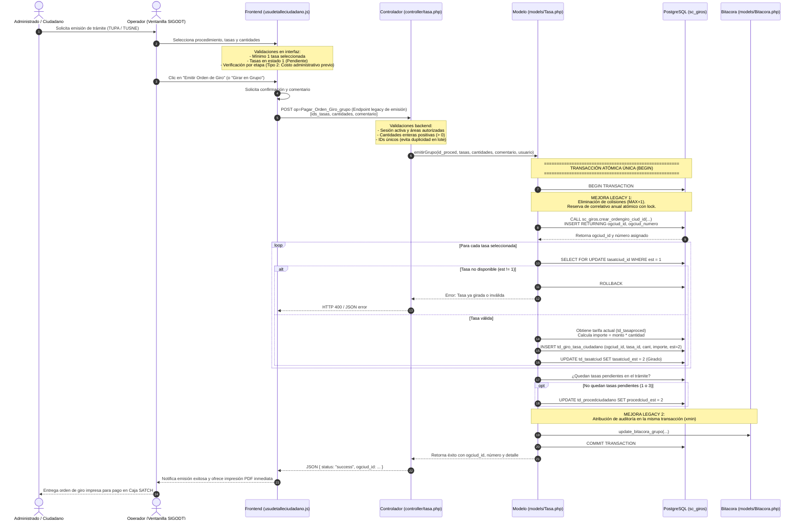
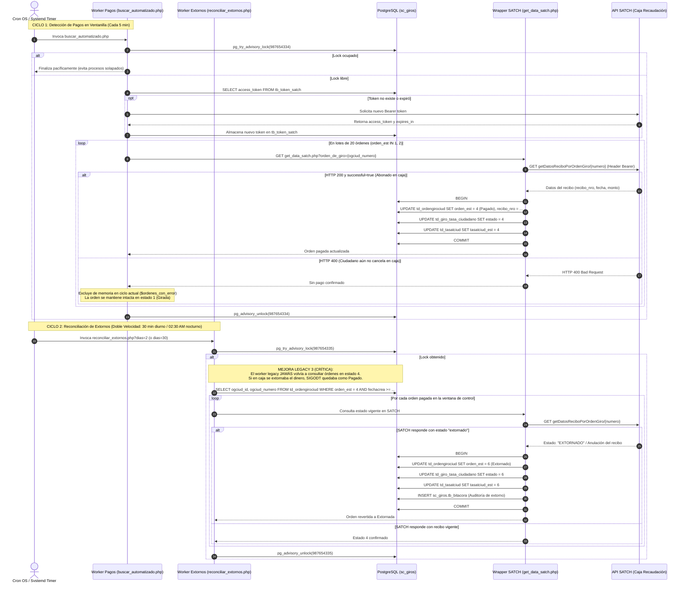
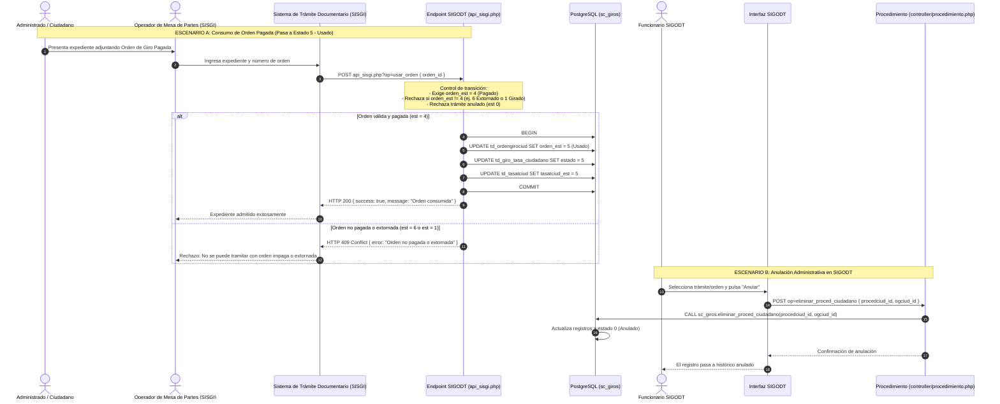

# Flujo Integral de Emisión, Pago, Extorno y Consumo de Órdenes de Giro en SIGODT

Este documento describe la arquitectura, la máquina de estados y los flujos de interacción para las órdenes de giro en **SIGODT**, detallando la integración con **SATCH** (Caja / Recaudación) y **SISGI** (Mesa de Partes / Trámite Documentario), e identificando las **mejoras técnicas frente al código legacy** que se encontraba en producción.

---

## 1. Máquina de Estados y Ciclo de Vida de una Orden

Una orden de giro no tiene un estado desconectado de sus tasas y trámite. Existen 3 niveles de entidad que interactúan:

| Nivel | Entidad de Base de Datos | Estados Típicos |
|---|---|---|
| **Trámite** | `sc_giros.td_procedciudadano` | `1` (Iniciado / Pendiente), `2` (En curso / Con orden), `0` (Anulado) |
| **Tasa** | `sc_giros.td_tasatciud` | `1` (Pendiente), `2` (Girado), `4` (Pagado), `5` (Usado), `6` (Extornado), `0` (Anulado) |
| **Orden de Giro** | `sc_giros.td_ordengirociud` | `1` (Girado), `4` (Pagado), `5` (Usado), `6` (Extornado), `0` (Anulado) |

### Transición de Estados
```text
           [ 1: Pendiente ] (Tasa en trámite)
                  │
                  ▼ (Emisión individual o grupal)
           [ 1 / 2: Girado ] (Orden emitida con correlativo anual atómico)
                  │
                  ▼ (Caja SATCH cobra en ventanilla)
           [ 4: Pagado ] (Worker detecta recibo_nro en SATCH)
            ┌─────┴─────────────────────────┐
            │                               │
            ▼ (Mesa de partes / SISGI)      ▼ (Ventanilla SATCH anula el cobro)
     [ 5: Usado ]                    [ 6: Extornado ]
(Expediente ingresado a trámite)    (Reconciliador de extornos detecta devolución)
```

---

## 2. Diagramas de Secuencia

### Diagrama 1: Flujo de Emisión de Orden de Giro (Individual y Grupal)

Muestra cómo el operador en ventanilla solicita y genera la orden de giro. Destaca la transacción unificada y el correlativo anual atómico.



---

### Diagrama 2: Sincronización de Pagos y Reconciliación de Extornos con SATCH

Muestra la interacción en segundo plano con la API de recaudación del SATCH, abordando tanto la confirmación de pago en ventanilla como la corrección ante devoluciones de dinero (extornos).



---

### Diagrama 3: Consumo de la Orden en SISGI y Anulación

Muestra el consumo final de la orden de giro al ingresar el trámite en Mesa de Partes (SISGI) y el canal de anulación administrativa.



---

## 3. Resumen Comparativo: Código Legacy vs Arquitectura Actual

| Componente | Comportamiento en Código Legacy (Producción Anterior) | Solución Optimizada Implementada | Impacto Técnico y de Negocio |
|---|---|---|---|
| **Generación de Correlativos** | `SELECT MAX(ogciud_numero) + 1` o llamada no bloqueante a `obtenerultimovalor()` sin transacción. | Procedimiento atómico `crear_ordengiro_ciud_id` con secuencia o contador anual con lock por año. | **Eliminó colisiones de concurrencia y números duplicados** cuando múltiples ventanillas emitían a la vez. |
| **Emisión de Tasas en Lote** | Bucles `for` en PHP con llamadas independientes y autocommit. Si la tasa 3 fallaba, las tasas 1 y 2 quedaban huérfanas. | Transacción unificada `emitirGrupo` (`BEGIN / COMMIT`) con `SELECT FOR UPDATE` sobre tasas pendientes. | **Atomicidad garantizada (ACID)**: Si falla un ítem, toda la orden y su contador revierten limpiamente. |
| **Detección de Extornos (SATCH)** | **Ceguera total de extornos**: El worker `buscar_automatizado.php` solo leía órdenes `1` y `2`. Una vez en `4` (Pagado), jamás se volvían a consultar. | Worker `reconciliar_extornos.php` con estrategia de **Doble Velocidad** (diurno 30m / nocturno 30d). | **Mitigó fraude y uso indebido**: Impide que un administrado cobre la devolución en SATCH y continúe el trámite en SIGODT. |
| **Bloqueo de Workers (Cron)** | Sin control de solapamiento; múltiples instancias concurrentes del cron saturaban la BD y la API del SATCH. | Uso de PostgreSQL Advisory Locks (`pg_try_advisory_lock`). | Salida pacífica si hay un proceso en ejecución; **cero saturación de hilos y cero bloqueos de tablas**. |
| **Búsqueda de Administrados** | `ILIKE '%termino%'` sobre tablas con cientos de miles de registros sin índices trigram, con scans secuenciales de 1.4s+. | Índices GIN Trigram (`pg_trgm`) en PostgreSQL + pushdown de predicados en SQL. | **Tiempos de respuesta reducidos de ~1400ms a ~250ms** (~82% de mejora en velocidad de consulta). |
| **Seguridad de Autenticación** | CAPTCHA con vigencia excesiva de 5 minutos; autenticación local desacoplada. | CAPTCHA reducido a 2 minutos fail-closed + Integración SIGUR blanqueamiento con JWT/JWE tolerante a fallos. | **Protección contra replay attacks y credenciales unificadas** institucionalmente. |
| **Reportes y Filtros Operativos** | Textos e importes rígidos que asumían siempre "Solo emitidos" y "Dinero no recaudado", confundiendo al filtrar solo Pagados. | Resúmenes dinámicos y adaptativos según el estado de orden seleccionado en tiempo real. | **Coherencia visual y auditoría fidedigna** para directores y fiscalizadores. |
| **Interfaz y Accesibilidad** | Menús sobrecargados con switchers de tema rotos (`dropdown-menu-arrow`) y peticiones AJAX globales innecesarias (`cargarSistemas`). | Limpieza de peticiones muertas, affordance claro con chevron bold y opciones con íconos vectoriales SVG. | **Menor consumo de ancho de banda y mayor usabilidad** para los operadores de ventanilla. |
