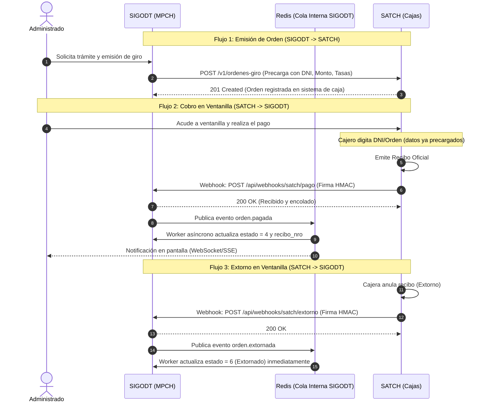

# Propuesta de Arquitectura: Integración Basada en Eventos entre SIGODT y SATCH (Webhooks + Redis)

> **Documento Técnico de Propuesta Arquitectónica**  
> **Destinatarios:** Jefatura de TI / Gerencia de Tecnología de la MPCH & Equipo Técnico de Desarrollo SATCH  
> **Estado:** Propuesta de Evolución (Fase 2)  
> **Autor:** Arquitectura de Software - SIGODT  

---

## 1. Resumen Ejecutivo y Diagnóstico del Modelo Actual

Actualmente, la sincronización entre el **Sistema de Gestión de Órdenes de Giro (SIGODT)** y el **Servicio de Administración Tributaria de Chiclayo (SATCH)** opera bajo un patrón de **Polling (sondeo periódico por lotes)** ejecutado mediante tareas Cron cada 5 minutos ([`api/buscar_automatizado.php`](file:///home/renzosandovalmio/Proyectos/SIGODT/api/buscar_automatizado.php)).

### 1.1 Ineficiencias del Modelo de Polling
1. **Desperdicio de Recursos y Tráfico Inútil:** Más del **85%** de las consultas a la API de SATCH devuelven `HTTP 400 Bad Request` ("Sin recibos asociados") porque corresponden a órdenes giradas que el administrado todavía no ha pagado en ventanilla.
2. **Latencia Innecesaria:** Cuando un ciudadano paga en ventanilla de SATCH, debe esperar hasta 5 minutos a que el cron despierte para que su orden cambie a `Pagada` y el personal de la MPCH pueda continuar con el trámite.
3. **Ventana de Riesgo en Extornos (Reversiones de Caja):** Si un cajero extorna un pago por error de digitación o reclamo inmediato, el sistema SIGODT no lo detecta hasta la siguiente ejecución del reconciliador, abriendo una brecha donde un funcionario podría emitir resoluciones o carnés con pagos anulados.
4. **Riesgo de Saturación en Picos Tributarios:** En campañas de amnistía o fin de mes, miles de peticiones automáticas compiten por ancho de banda y conexiones de base de datos contra los pagos legítimos en caja.

---

## 2. Visión Objetivo: Arquitectura Basada en Eventos (Event-Driven REST)

Se propone evolucionar de una arquitectura pasiva (*«SIGODT pregunta a cada rato si ya pagaron»*) a una arquitectura reactiva e invertida (*«SATCH avisa a SIGODT en el milisegundo exacto en que la cajera cobra o extorna»*), complementada con la precarga de órdenes desde SIGODT hacia SATCH.



---

## 3. Especificación de Contratos e Interfaces de Integración

### 3.1 Contrato 1: Registro de Orden Girada (`SIGODT → SATCH`)
Permite que SATCH conozca de antemano la orden de giro generada en la MPCH.

* **Método:** `POST`
* **Endpoint en SATCH:** `https://api.satch.gob.pe/v1/ordenes-giro`
* **Autenticación:** `Bearer Token` (OAuth2 M2M)
* **Payload:**
```json
{
  "ordenGiro": "027053-2026",
  "fechaEmision": "2026-10-21T10:15:00",
  "administrado": {
    "tipoDocumento": "DNI",
    "numeroDocumento": "60775131",
    "nombreCompleto": "RENZO HECTOR JOSE SANDOVAL MIO"
  },
  "areaEmisora": "SUBGERENCIA DE SANIDAD",
  "procedimiento": "CARNE SANITARIO",
  "montoTotal": 45.00,
  "conceptos": [
    {
      "tasaId": 82544,
      "codigoTributo": "010203",
      "descripcion": "DERECHO DE EMISIÓN DE CARNÉ DE SANIDAD",
      "cantidad": 1,
      "monto": 45.00
    }
  ],
  "expiracion": "2026-11-20T23:59:59"
}
```
* **Impacto en SATCH:** El cajero solo ingresa el DNI o el número de orden y la pantalla de cobro carga automáticamente los tributos sin riesgo de manipulación de montos.

---

### 3.2 Contrato 2: Webhook de Notificación de Pago (`SATCH → SIGODT`)
Disparado por SATCH inmediatamente después de imprimir el comprobante de caja.

* **Método:** `POST`
* **Endpoint en SIGODT:** `https://sigodt.munichiclayo.gob.pe/api/webhooks/satch/pago`
* **Cabeceras de Seguridad:**
  * `X-Satch-Signature`: Firma `HMAC-SHA256` del payload usando un secreto compartido.
  * `X-Satch-Event-Id`: UUID único del evento (para garantizar idempotencia).
  * `X-Satch-Timestamp`: Marca de tiempo Unix (rechaza peticiones con desfase > 300 segundos).
* **Payload:**
```json
{
  "evento": "orden_giro.pagada",
  "eventoId": "evt_9b1deb4d-3b7d-4bad-9bdd-2b0d7b3dcb6d",
  "timestamp": "2026-10-21T10:25:30Z",
  "data": {
    "ordenGiro": "027053-2026",
    "numeroRecibo": "202600146459",
    "fechaPago": "2026-10-21T10:25:28",
    "cajero": "caja_central_04",
    "montoPagado": 45.00,
    "formaPago": "EFECTIVO"
  }
}
```
* **Respuesta esperada de SIGODT:** `HTTP 200 OK` con `{ "success": true, "status": "QUEUED" }` en menos de 200 ms.

---

### 3.3 Contrato 3: Webhook de Notificación de Extorno (`SATCH → SIGODT`)
Disparado por SATCH al realizar una anulación/reversión de recibo en ventanilla o tesorería.

* **Método:** `POST`
* **Endpoint en SIGODT:** `https://sigodt.munichiclayo.gob.pe/api/webhooks/satch/extorno`
* **Payload:**
```json
{
  "evento": "orden_giro.extornada",
  "eventoId": "evt_c83f124a-711e-4501-8bfe-3fa3c5dbd1e9",
  "timestamp": "2026-10-21T10:45:10Z",
  "data": {
    "ordenGiro": "027053-2026",
    "numeroRecibo": "202600146459",
    "fechaExtorno": "2026-10-21T10:45:00",
    "motivo": "ERROR DE CONCEPTO SOLICITADO POR EL ADMINISTRADO",
    "autorizadoPor": "SUPERVISOR_CAJA_01"
  }
}
```

---

## 4. El Rol Arquitectónico de Redis: ¿Por qué y Dónde?

> [!IMPORTANT]
> **Delimitación de Frontera:** Redis **NO** debe exponerse públicamente entre instituciones. Redis debe operar exclusivamente como **componente interno dentro de la infraestructura de SIGODT**.

### 4.1 Problemas de usar Redis directo entre SIGODT y SATCH
* **Seguridad:** Requiere abrir el puerto `6379` entre redes institucionales distintas, aumentando la superficie de ataque.
* **Pérdida de mensajes (Fire-and-forget):** En Redis Pub/Sub, si un suscriptor está reiniciándose o hay un parpadeo de red, los mensajes no entregados se pierden permanentemente.

### 4.2 Arquitectura Interna Correcta con Redis en SIGODT
Redis se ubica como **amortiguador asíncrono y acelerador en memoria** dentro del servidor de SIGODT:

```text
[Webhook de SATCH] 
       │ (HTTP POST)
       ▼
[Endpoint Ligero SIGODT (PHP)] ──► Verifica Firma HMAC en < 10ms
       │
       ├─► Responde 200 OK a SATCH de inmediato (No bloquea la caja)
       │
       ▼ Encola en Redis Stream / List
[Redis: cola_eventos_satch]
       │
       ▼ Consume en segundo plano (Daemon / Worker PHP)
[Actualizador Atómico de BD PostgreSQL]
       │
       ├─► Actualiza td_ordengirociud a estado 4 o 6
       │
       └─► Publica en Redis Pub/Sub ──► Servidor SSE / WebSocket
                                                │
                                                ▼
                                   [Pantalla del Funcionario]
                                   (Se pinta "Pagado" sin F5)
```

### Ventajas de este desacoplamiento:
1. **Respuesta ultrarrápida a SATCH:** SATCH recibe confirmación en 15 ms y la cajera no sufre congelamientos de interfaz.
2. **Tolerancia a fallos:** Si la base de datos PostgreSQL de SIGODT está ocupada con un backup o reporte pesado, el webhook no falla: queda resguardado en la cola de Redis y se procesa en cuanto haya capacidad.
3. **Caché de Tokens SATCH:** El token Bearer se almacena en Redis con TTL automático, eliminando las lecturas a `tb_token_satch` en PostgreSQL.

---

## 5. Matriz de Seguridad y Resiliencia

| Mecanismo | Implementación | Propósito |
|---|---|---|
| **Cifrado en Tránsito** | TLS 1.3 / HTTPS obligatorio con certificados válidos | Evita intercepción o lectura de datos en la red municipal. |
| **Firma Criptográfica** | `HMAC-SHA256` con secreto compartido en cabecera `X-Satch-Signature` | Garantiza que nadie externo pueda simular falsos pagos en SIGODT. |
| **Protección contra Replay** | Validación de timestamp (`abs(now - timestamp) < 300s`) | Evita que un atacante capture una petición legítima y la reenvíe. |
| **Idempotencia Absoluta** | Tabla de eventos procesados en PostgreSQL (`tb_webhook_log`) con clave única `evento_id` | Si SATCH reintenta el envío de un pago, SIGODT no duplica actualizaciones. |
| **Política de Reintentos en SATCH** | Exponential Backoff (reintentos a los 10s, 30s, 2m, 10m, 1h) con Dead-Letter Queue | Garantiza entrega en caso de reinicio de servidores de SIGODT. |

---

## 6. Plan de Transición y Hoja de Ruta (Roadmap)

```text
┌─────────────────────────────────────────────────────────────────────────────┐
│ FASE 1: Estabilización Inmediata (Estado Actual)                            │
│ - Implementada con los workers cron en docs/cron-workers-satch.md           │
│ - Estrategia de doble velocidad (dias=2 diurno, dias=30 nocturno)          │
│ - 100% autónomo de SIGODT (no requiere aprobaciones de terceros)            │
└──────────────────────────────────────┬──────────────────────────────────────┘
                                       │
                                       ▼
┌─────────────────────────────────────────────────────────────────────────────┐
│ FASE 2: Webhook de Pagos y Extornos SATCH -> SIGODT (Mediano Plazo)        │
│ - Coordinación técnica con equipo de desarrollo SATCH                       │
│ - Implementación de endpoints receptores en SIGODT con validación HMAC      │
│ - Apagado gradual de las consultas masivas de buscar_automatizado.php       │
└──────────────────────────────────────┬──────────────────────────────────────┘
                                       │
                                       ▼
┌─────────────────────────────────────────────────────────────────────────────┐
│ FASE 3: Integración Bidireccional Completa y Tiempo Real Total              │
│ - Precarga de órdenes giradas desde SIGODT hacia SATCH al emitir           │
│ - Redis interno para eventos SSE/WebSocket hacia la interfaz web            │
│ - Erradicación definitiva de cron jobs de sondeo                            │
└─────────────────────────────────────────────────────────────────────────────┘
```

---

## 7. Próximos Pasos Recomendados

1. **Desplegar y mantener activa la Fase 1** mediante las directivas de [`docs/cron-workers-satch.md`](file:///home/renzosandovalmio/Proyectos/SIGODT/docs/cron-workers-satch.md) para garantizar la continuidad del servicio hoy.
2. **Agendar mesa técnica** con la jefatura de desarrollo del SATCH para validar la viabilidad técnica y calendarizar la Fase 2 (Webhooks de pago y extorno).
